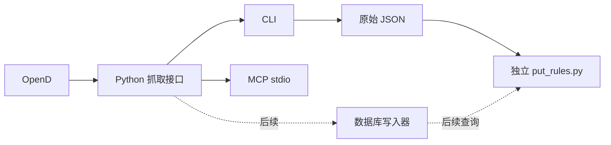

# 可复用抓取接口与 MCP

抓取代码在 `apps/python/moopython/market_collection.py`，命令行和 MCP 都调用 `MarketDataService`。规则引擎保留在独立的 `modules/put-screener/put_rules.py`。MCP 是调用适配层，数据库和策略都不写在 MCP 内。



## Python 接口

```python
from moopython.market_collection import opend_connection

with opend_connection() as data:
    quotes = data.snapshots(['US.AVGO', 'US.NVDA'])
    chain = data.option_chain('AVGO', months=3, option_type='PUT')
    daily = data.daily_bars(['AVGO'])
    earnings = data.earnings_calendar('2026-10-19', '2026-10-25')
    # 完整输入：合约、快照、财报、日线；直接交给独立规则文件
    dataset = data.collect_put_dataset(['AVGO', 'NVDA'], months=3)
```

接口只返回可 JSON 序列化的数据，不写文件、不算策略指标。`snapshots` 接受 1–200 个股票或期权代码，保留全部 broker 字段、时间、来源和缺失代码；`daily_bars` 返回约 550 个自然日范围内的已完成复权日线，包含实际可用交易日期。多股票批量采集上限 20。当前这些研究接口支持美股；现有桌面的其他市场功能不受影响。

已有 `OptionChainService` 继续承担期权链的日期拆分、限流和数据验证。完整 Put 采集通过同一组基础接口组合，不在 MCP 内另写采集或规则逻辑。MCP 调用串行执行，并在调用间留出 OpenD 限流间隔；使用完关闭 quote context。多个独立进程仍共享券商限额，可能收到限流错误。

## CLI 与安装

在已登录的本机 OpenD 启动后，从仓库根目录运行：

```sh
# 使用已有 SDK 环境，源码入口继续兼容
apps/python/.venv/bin/python scripts/collect-put-data.py AVGO NVDA AAPL \
  --output artifacts/put-screen/input.json

# 安装 wheel 或源码后，同样的功能使用正式入口
./setup.sh
./moomoo collect AVGO NVDA --output artifacts/put-screen/input.json
./moomoo mcp --port 11111
```

Python wheel 同时提供 `moomoo-options`、`moomoo-data`、`moomoo-mcp`。MCP 使用官方 `mcp>=2.3,<3` SDK，作为可选依赖；普通抓取和独立规则运行不依赖 MCP。默认 wheel 安装只要求 SDK，MCP 为可选依赖；桌面 Qt 通过 `[desktop]` 额外安装。DMG 继续由现有 CI 构建；MCP 通过 Python 入口启动，无需为修改规则重新构建 DMG。

MCP host 配置示例（替换成自己的绝对路径）：

```json
{
  "mcpServers": {
    "moomoo-market-data": {
      "command": "/ABSOLUTE/PATH/moomoo-clients/moomoo",
      "args": ["mcp"]
    }
  }
}
```

Windows 使用 `setup.ps1` / `moomoo.ps1`，MCP 宿主直接启动 `apps/python/.venv/Scripts/python.exe -X utf8 -m moopython.market_mcp`。详见根目录 README 的平台步骤。

服务使用本地 stdio；所有 SDK 诊断信息走 stderr。启动和工具发现不连接 broker；第一次读取时才连接已登录的本机 OpenD。没有在用户的 MCP host 中自动注册或修改配置。

| MCP 工具 | 基础接口 | 返回内容 |
| --- | --- | --- |
| `get_market_snapshots` | `snapshots` | 标的或合约快照，包含可用的 Bid/Ask、Delta、IV、量和持仓量 |
| `get_option_chain` | `option_chain` | 合约、到期日、行权价；默认一个月，可传日期范围 |
| `get_daily_bars` | `daily_bars` | 已收盘常规时段 QFQ 日线及交易日历 |
| `get_earnings_calendar` | `earnings_calendar` | 1–7 天的财报日历和来源说明 |

优先小批量查询；期权链使用较短日期范围。完整合约快照更适合由 CLI 采集并存文件，避免向模型一次返回几千条记录。所有 MCP 工具标记只读，未开放交易、账户、任意路径读写或自动挑选合约。数据权限、缺失和行情服务错误会明确返回。

## 数据时点与后续存储

原始日线和报价是抓取层的职责，MA、RSI、MACD、ATR 和选 Put 条件属于独立分析层。保存原始数据后修改指标不需要再向 broker 抓一遍。字段结构、来源、采集时间、市场时区和交易日一同保留；规则报告另有规则版本及输入指纹。

`cutoff` 限制可使用的已完成日线，不会重建历史时点的公告、财报预测或复权版本；历史补取会另外记录 `fetched_at`。它不能代替真正的历史逐时点数据或期权策略回测。财报未列出仍属于未知。

当前落盘格式是 JSON，数据库与清理优先级较低，暂不实现。后续加数据库时，存储写入器消费同一套抓取结果，查询器还原同样的分析输入；CLI 和 MCP 继续调用这些服务。日线、报价快照和分析结果分别设置保留策略，清理依据采集时间/交易日，保留被分析报告引用的数据，避免静默改变旧报告。具体数据库和保留天数后续再定。

## 验证

```sh
PYTHONPATH=apps/python python3.14 -m unittest discover -s apps/python/tests/unit -v
python3.14 -m unittest discover -s modules/put-screener/tests -v
# 安装 MCP 可选依赖后：真正启动 stdio 子进程，使用官方 client 测试发现和调用
PYTHONPATH=apps/python python3.14 -m unittest discover -s apps/python/tests/mcp -v
```

协议测试使用合成 provider，检查工具发现、只读标记、结构化输出、输入错误和服务端错误后的继续调用。CI 在无 Qt、无 moomoo SDK 的环境验证适配层，再由现有 macOS 流程测试完整客户端和 wheel。

协议依据：[官方 Python SDK](https://github.com/modelcontextprotocol/python-sdk)、[MCP 服务开发文档](https://modelcontextprotocol.io/docs/develop/build-server)。
