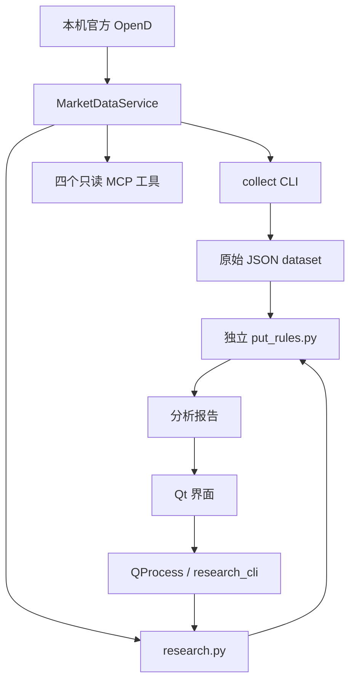

# 架构与扩展位置

抓取提供数据，独立规则解释和排序，CLI / MCP / GUI 负责适配调用。当前使用 JSON 保存输入与报告。

## 修改位置

| 需求 | 主要文件 | 约定 |
| --- | --- | --- |
| 新增或修正行情字段 | [market_collection.py](../../apps/python/moopython/market_collection.py) | 数据标准化、来源、时间、缺失和错误；不写策略 |
| 合约查询窗口与限流 | [options.py](../../apps/python/moopython/options.py) | 复用 `OptionChainService` |
| 修改 Filter、指标、评分或趋势文字 | [put_rules.py](../../modules/put-screener/put_rules.py) | 唯一规则实现，标准库依赖，更新规则版本 |
| 组合研究流程 | [research.py](../../apps/python/moopython/research.py) | 复用采集与规则；不依赖 Qt / MCP |
| 研究进程 JSON 边界 | [research_cli.py](../../apps/python/moopython/research_cli.py) | SDK 在子进程主线程；日志不污染结果 |
| MCP 参数与协议 | [market_mcp.py](../../apps/python/moopython/market_mcp.py) | 薄适配层，共用采集；不实现策略或存储 |
| 桌面展示与配置 | [research_ui.py](../../apps/python/moopython/research_ui.py)、[research_controls.py](../../apps/python/moopython/research_controls.py) | 传配置并展示引擎证据，不复制计算公式 |
| 原生候选表格 | [research_table.py](../../apps/python/moopython/research_table.py) | 展示已排序的 Top N；表头请求完整缓存重算，不自行排序可见行 |
| wheel 规则快照 | [setup.py](../../apps/python/setup.py) | 构建时复制独立规则，不手动维护第二份 |

## 规则加载与桌面进程

`research.load_rules()` 优先读取源码的独立规则文件；源码不存在时读取 wheel 内 `_bundled_put_rules.py`，再查冻结包路径。源码编辑可直接重跑；已分发的 wheel / EXE / DMG 需重新构建。

桌面通过 QProcess 运行研究 CLI。SDK 在子进程主线程执行，窗口关闭或取消时停止该工作进程；冻结的 windowed 应用通过临时 JSON 文件交换结果。不要改为 GUI 主线程直接请求 SDK，也不要依赖冻结程序一定存在 stdout。

完整采集输入缓存于界面；改配置时重新分析该输入，保留时点。切换股票或端口后清空，点击主查询按钮再获取新数据。

## 以后添加数据库

数据库、保留期限和自动清理当前未实现。以后由存储写入器消费同一采集结果，查询层还原同样的 dataset，再交给同一引擎。MCP 不直接依赖具体数据库，规则不发起网络查询。日线、快照与报告分别保存来源和时间，清理应考虑报告引用。更多约定见[数据接口](../market-data.md)。
