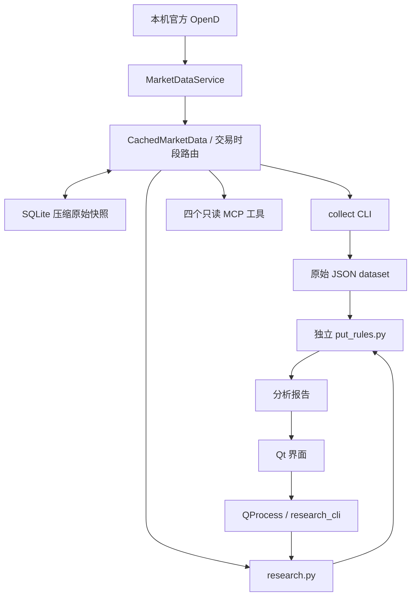

# 架构与扩展位置

抓取提供数据，共享路由决定读 OpenD 或 SQLite，独立规则解释和排序，CLI / MCP / GUI 负责适配调用。JSON 仍用于导出输入与报告。

## 修改位置

| 需求 | 主要文件 | 约定 |
| --- | --- | --- |
| 新增或修正行情字段 | [market_collection.py](../../apps/python/moopython/market_collection.py) | 数据标准化、来源、时间、缺失和错误；不写策略 |
| 查询时段与缓存策略 | [market_repository.py](../../apps/python/moopython/market_repository.py)、[market_sessions.py](../../apps/python/moopython/market_sessions.py) | 延迟连接 OpenD，盘后优先查匹配缓存、缺失自动抓取，保留原始时间 |
| 持久化快照与清理 | [market_store.py](../../apps/python/moopython/market_store.py)、[database](../../apps/python/moopython/database)、[database_cli.py](../../apps/python/moopython/database_cli.py) | 独立版本化 SQL 迁移、压缩、校验和、保留期与清理；不写规则 |
| 多股票快照复用 | [market_payloads.py](../../apps/python/moopython/market_payloads.py) | 批次投影为单股，组合时保留各自采集来源；不计算指标 |
| 股票名称目录与候选 | [security_directory.py](../../apps/python/moopython/security_directory.py)、[symbol_search.py](../../apps/python/moopython/symbol_search.py) | 同一 SQLite 的证券 / 别名表；本地前缀与通配符匹配，用户选定代码后才研究，显式同步目录 |
| 合约查询窗口与限流 | [options.py](../../apps/python/moopython/options.py) | 复用 `OptionChainService` |
| 修改 Filter、指标、评分或趋势文字 | [put_rules.py](../../modules/put-screener/put_rules.py) | 唯一规则实现，标准库依赖，更新规则版本 |
| 组合研究流程 | [research.py](../../apps/python/moopython/research.py) | 复用采集与规则；不依赖 Qt / MCP |
| 独立价格信号 | [price_signals.py](../../apps/python/moopython/price_signals.py)、[price_signal_view.py](../../apps/python/moopython/price_signal_view.py) | 复用已验证日线识别潜在价位，单独展示；不写入现有排名、分数或 Filter，不将历史转折称为当前挂单 |
| 股票名单与预检查 | [watchlist.py](../../apps/python/moopython/watchlist.py)、[watchlist_cli.py](../../apps/python/moopython/watchlist_cli.py) | 全名单格式和证券身份验证通过才分析，逐股保留结果与错误；复用独立规则 |
| 桌面全名单研究与管理 | [watchlist_research.py](../../apps/python/moopython/watchlist_research.py)、[watchlist_store.py](../../apps/python/moopython/watchlist_store.py)、[watchlist_dialog.py](../../apps/python/moopython/watchlist_dialog.py) | 原始输入合并后调用同一规则；SQLite 成员表、旧 JSON 一次迁入、核验添加、暂存删除后确认 |
| 研究进程 JSON 边界 | [research_cli.py](../../apps/python/moopython/research_cli.py) | SDK 在子进程主线程；日志不污染结果 |
| 桌面收盘结果 | [saved_research.py](../../apps/python/moopython/saved_research.py) | 已完成交易日、原始输入和预计算报告复用；默认读取不刷新已有行情，更新走原始路由 |
| MCP 参数与协议 | [market_mcp.py](../../apps/python/moopython/market_mcp.py) | 薄适配层，共用采集；不实现策略或存储 |
| 桌面展示与配置 | [research_ui.py](../../apps/python/moopython/research_ui.py)、[research_controls.py](../../apps/python/moopython/research_controls.py) | 传配置并展示引擎证据，不复制计算公式 |
| 原生候选表格 | [research_table.py](../../apps/python/moopython/research_table.py) | 展示已排序的 Top N；表头请求完整缓存重算，不自行排序可见行 |
| wheel 规则快照 | [setup.py](../../apps/python/setup.py) | 构建时复制独立规则，不手动维护第二份 |
| 股票策略与模拟引擎 | [paper_strategies.py](../../apps/python/moopython/paper_strategies.py)、[paper_engine.py](../../apps/python/moopython/paper_engine.py) | 纯函数、版本化参数、下一交易日开盘、现金流与公司行动；与Put排名分离 |
| 模拟数据与账本 | [paper_data.py](../../apps/python/moopython/paper_data.py)、[paper_store.py](../../apps/python/moopython/paper_store.py) | 共用行情路由；原始OHLC / 公司行动；SQLite事务、压缩审计输入，不参加行情清理 |
| 模拟入口与界面 | [paper_cli.py](../../apps/python/moopython/paper_cli.py)、[paper_ui.py](../../apps/python/moopython/paper_ui.py) | headless CLI与Qt QProcess；前向 / 回测明确分开 |

## 规则加载与桌面进程

`research.load_rules()` 优先读取源码的独立规则文件；源码不存在时读取 wheel 内 `_bundled_put_rules.py`，再查冻结包路径。源码编辑可直接重跑；已分发的 wheel / EXE / DMG 需重新构建。

桌面通过 QProcess 运行研究 CLI。SDK 在子进程主线程执行，窗口关闭或取消时停止该工作进程；冻结的 windowed 应用通过临时 JSON 文件交换结果。不要改为 GUI 主线程直接请求 SDK，也不要依赖冻结程序一定存在 stdout。

完整采集输入缓存于界面；改配置时重新分析该输入，保留时点。切换股票或端口后清空界面输入，桌面主查询默认读取已保存收盘结果，原始采集 CLI / MCP 继续按时段路由；右下角「更新行情」显式更新。

## 数据库

SQLite 保存压缩后的原始采集结果，路由层还原同样的 dataset，再交给同一引擎。MCP 不直接实现存储，规则不发起网络查询。多股票共用快照表，单股记录按批次关联；保留期由用户设定，默认关闭，配置后查询时每天至多一次清理旧版本。时段、schema、路径、刷新与清理约定见[数据库说明](../guides/database.md)。
